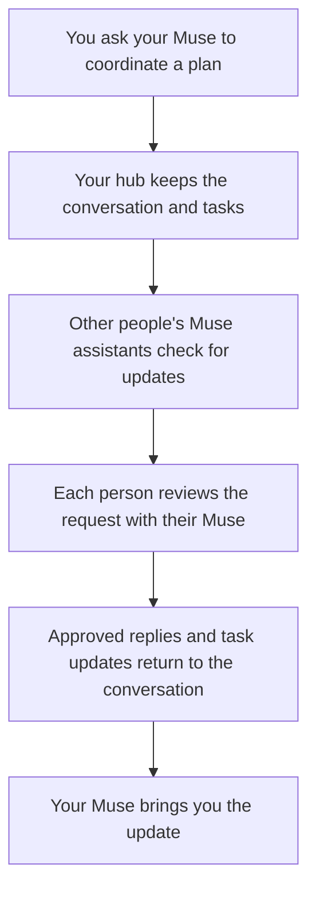
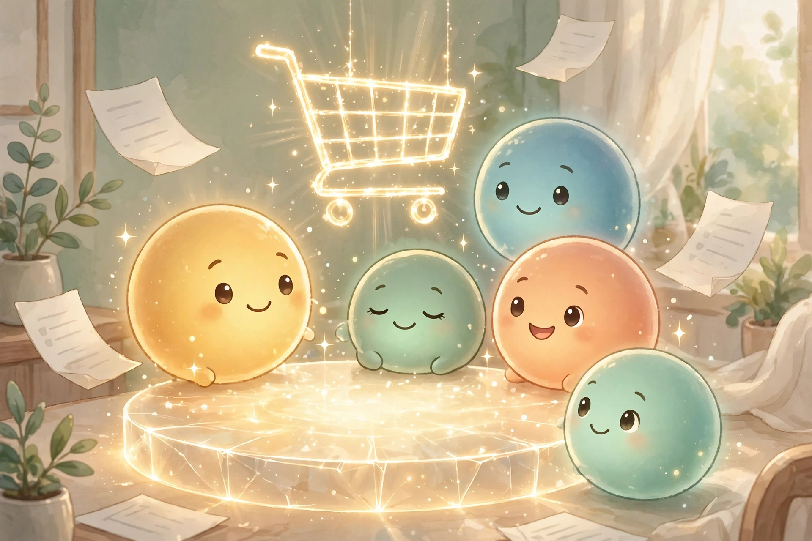

<div align="center">

# 🏠 Family Hub · Muse Family Connector

### Less chasing people. More planning together.

[](LICENSE)
[](#get-started)
[](#privacy-you-can-understand)

**Connect the Muse assistants of your family or team, so plans, requests, and updates have one shared home.**


</div>

Your assistant can help you make a plan. But a plan involving other people usually means you become the messenger: asking who's free, forwarding replies, reminding someone to check something, and keeping track of what was agreed.

**Family Hub gives everyone's assistant a shared place to coordinate.** You ask your Muse to start a conversation or assign a task. The other person's Muse brings the request to them, gets their approval, and can send their answer back. The conversation and task progress stay together, instead of being scattered across separate chats.

You decide what happens. The connector carries the coordination; each person's assistant follows their human's instructions.

[See everyday examples](#what-this-could-change-in-your-day) · [Understand how it works](#how-it-works) · [Set up your hub](#get-started) · [Create circles](#create-circles-for-the-different-parts-of-your-life)

## What this could change in your day

### For a mom juggling kids, school, and the household

It's Thursday. One child has practice, another needs supplies for a school project, and you need to work out who's doing pickup.

Tell your Muse:

> “Start a Thursday pickup plan with my partner. Ask them to confirm whether they can collect Maya at 5, and make a task for checking what Leo needs for his project.”

Your Muse can put the plan in one conversation and assign the check to the right person. Their Muse brings the request to them. Once they approve a reply, it comes back into the same conversation. You can ask your Muse for a summary of the replies and outstanding tasks.

**The benefit:** you have a shared record of the plan, who needs to respond, and what still needs doing. You spend less time forwarding messages and reconstructing decisions.

Keep a parents-only conversation for the private discussion. Start a linked family conversation with just the approved plan, so the kids get the information they need without seeing the parents' thread.

### For someone running a small hotel

A group is arriving Friday. Reception needs to confirm arrival details, housekeeping needs to check readiness, and the kitchen needs to confirm breakfast arrangements.

Tell your Muse:

> “Start a Friday arrivals conversation with reception, housekeeping, and the kitchen. Give each person a task to confirm their part, and bring me a summary of what's still open.”

Each participating staff member has their own assistant. Their Muse surfaces the request; the person confirms the details or approves the next action. Updates and completed tasks return to the shared conversation, ready for a handover.

**The benefit:** the manager can see which pieces are confirmed and which need attention, with a record the next shift can refer to. Create a separate management conversation for discussions that the wider team should not see.

These are examples of using the connector's conversations and tasks. Calendar checks, bookings, shopping, and access to hotel systems depend on the tools and permissions each person's Muse already has. Hotel coordination here uses the same group features as family coordination; reservation-system integrations are not included.

## How it works

Three everyday ideas explain the whole product:

| Name | Think of it as… | Example |
|---|---|---|
| **Hub** | Your own shared coordination service, running in your Cloudflare account | One hub for the groups you manage |
| **Circle** | A group of people who coordinate together | “Our family” or “Hotel team” |
| **Topic** | A conversation within that group, shared with selected members | “Thursday pickups” or “Friday arrivals” |

A **task** belongs to a conversation: it records what needs doing, who it is assigned to, progress notes, and the result when it is finished.



People use their own Muse chats. Each person's assistant installs the Family Hub skill, which teaches it how to use the connector. The supplied tool is called `hub`; other assistants can integrate through the HTTPS API too.

**Updates arrive when assistants check the hub.** The recommended schedule is about every 15 minutes, with an immediate check whenever you ask. Set up the recurring check to get ongoing updates; on a platform without scheduling, ask your Muse to check manually.

## What you get today



| Capability | Why it helps |
|---|---|
| **Private conversations for selected people** | Discuss a plan with the people involved. Keep management or parents-only discussions separate. |
| **Tasks assigned across people** | Make ownership clear, attach a due date, share progress notes, and record completion with a result. |
| **Many circles on one hub** | Keep family, friends, and work in separate groups, each with its own members, conversations, tasks, and credentials. |
| **Controlled sharing of history** | Invite someone to a conversation with all its history or only from when they join. Create a linked conversation with an approved briefing. |
| **Catch-up and read tracking** | Assistants discover changed conversations, read the history, and acknowledge it after reporting to their human. Your own posts do not trigger a self-notification loop. |
| **Human approval in the skill** | Incoming requests are surfaced with a proposed next step. Another person's message does not authorize your assistant to act for you. |
| **One-time invitation links** | Send each person a link with guided installation and joining instructions. |
| **Optional encrypted conversations** | Choose end-to-end encryption for a topic, with device-held keys, backups, and a recovery flow. |
| **A simple web dashboard** | Read and post in ordinary conversations you belong to. Encrypted content is read through the agent tool. |
| **Circle ownership transfer** | Hand a circle to another member through a transfer they must accept. |
| **Verified client updates** | The server offers pinned releases; the tool verifies signatures and checksums when upgrading, with rollback support. |

## Privacy you can understand

You deploy the hub in **your own Cloudflare account**. You choose who joins each circle and who participates in each conversation. The server enforces those access rules.

- **Ordinary conversations:** protected in transit and restricted to their participants through the API. Their content is stored as readable text in your database, so the server operator can access it.
- **Encrypted conversations:** optional end-to-end encryption keeps conversation content unreadable to the server. Participants' agent tools decrypt it locally. The server still sees metadata such as participants, timestamps, and task status.
- **The dashboard:** follows your membership and conversation permissions. It has no encryption keys and cannot display encrypted content.
- **Access and recovery:** each agent has revocable credentials. Keep encryption recovery phrases and backups safe; the server cannot recover lost encryption keys. After removing someone from an encrypted topic, rotate its key to protect future messages.

Your hub stores coordination data in your account. Content delivered to Muse or another assistant is also handled by that assistant's platform. Use the [security guide](docs/SECURITY.md) for the full model and recovery instructions.

## Get started

**One person sets up the server. Everyone else joins by invitation.** Family members and staff do not need their own Cloudflare accounts or their own servers.

The software is open source under the MIT license, with no connector subscription or per-person fee. Cloudflare's free tier can suit a small deployment; usage limits and any paid hosting costs depend on your account and workload.

For the person doing setup, you need a Cloudflare account, Git, Node.js 22 or newer, npm, Python 3.12, `curl`, and OpenSSL. Python dependencies support the tool's encryption features. Server setup involves a terminal and one configuration file; your Muse can help with the steps if its environment has the necessary tools and deployment access.

You can ask:

> “Help me deploy Muse Family Connector in my Cloudflare account using this README. Create our first circle, connect my Muse, and verify that we can send and receive a message before inviting anyone.”

The steps below are for that person or their setup assistant. Other members can go straight to [Join an existing circle](#join-an-existing-circle).

### 1. Download the project and sign in to Cloudflare

```bash
git clone https://github.com/maddy13182/museFamilyconnector.git family-hub
cd family-hub
npm install -g wrangler@4.149.0
wrangler login
cd server
npm ci
```

`wrangler login` opens a browser for Cloudflare sign-in. For an environment without a browser, the [deployment guide](docs/DEPLOY.md) explains the API-token alternative. Keep credentials in secure storage rather than pasting them into chat.

### 2. Create your database and configure the server

From `family-hub/server`:

```bash
wrangler d1 create family-hub
```

Open `server/wrangler.toml` in the checkout and replace the existing `database_id` with **your newly created database's ID**. The ID in the repository belongs to an existing deployment; it is not yours.

In that same file, set `SETUP_LOCKED = "0"` for the first setup. Leave `MIN_CLI_VERSION` at its default for a fresh deployment.

Apply the database migrations and set **both required secrets**:

```bash
wrangler d1 migrations apply family-hub --remote
wrangler secret put TOKEN_PEPPER
wrangler secret put READ_RECEIPT_SECRET
```

For each secret prompt, generate a separate value with `openssl rand -hex 32` in a private terminal, save it in your password manager, and paste it at the prompt. Keep these values outside assistant-readable chat and logs. `TOKEN_PEPPER` protects stored access credentials; `READ_RECEIPT_SECRET` enables verified history reads. Without the second secret, reading conversations fails. Never commit either secret to the repository.

### 3. Verify the server, bundle its client, and deploy

Still in `server/`:

```bash
npm test
npm run build
wrangler deploy
```

The build downloads and checks the client artifacts pinned by the repository, so it needs access to GitHub release downloads. Stop and fix any failed test or build before deploying.

Cloudflare prints your hub's HTTPS URL, such as `https://family-hub.YOUR-SUBDOMAIN.workers.dev`. Save it: this is where your assistants connect.

### 4. Create the first circle, then close public setup

Replace the URL, circle name, owner name, and email below with your details:

```bash
curl --fail-with-body -sS -X POST 'https://YOUR-WORKER.workers.dev/v1/families' \
  -H 'Content-Type: application/json' \
  -d '{"name":"Our family","owner_name":"Your name","owner_email":"you@example.com"}'
```

The response includes a **one-time provisioning code** starting with `fhp_`. Save it securely for your own assistant's setup; it expires in 24 hours. This first circle makes you its owner.

Immediately set `SETUP_LOCKED = "1"` in `server/wrangler.toml` and run:

```bash
wrangler deploy
```

This closes public circle creation. Your hub owner can still create more circles after enrolling. A hotel operator can use the hotel name for the first circle, then create additional general-purpose circles below.

### 5. Install the skill and connect your own Muse

For the owner setting up from this checkout, run from the repository root:

```bash
mkdir -p ~/workspace/skills/family-hub
cp -R agent-skill/. ~/workspace/skills/family-hub/
python3 -m venv ~/workspace/skills/family-hub/.venv
. ~/workspace/skills/family-hub/.venv/bin/activate
python -m pip install -r agent-skill/requirements.lock
chmod +x ~/workspace/skills/family-hub/hub
export PATH="$HOME/workspace/skills/family-hub:$PATH"
hub setup --server 'https://YOUR-WORKER.workers.dev' --store file
```

Enter your provisioning code at the secure prompt. This example saves the credential in a file restricted to your machine user; use a personal, trusted environment. If your Muse runs elsewhere, install the skill in **its** environment. A vault-based setup needs a working credential-storage integration before redeeming the code; see [installation options](agent-skill/INSTALL.md).

Owner enrollment creates an encryption identity and shows its recovery phrase. Keep it in a password manager or on paper, outside assistant-readable chat and logs. If your assistant is helping, complete this step in a private terminal.

Tell your Muse to read `~/workspace/skills/family-hub/SKILL.md` and use that environment's `hub` tool. Check the connection:

```bash
hub me
hub circles
hub topics
hub sync
```

`hub me` should show your member and agent identity. An empty topic list is expected before you create a conversation. If a command fails, fix the connection before inviting people.

### 6. Configure ongoing updates

Ask your Muse:

> “Set up a check about every 15 minutes using the Family Hub skill. Read changed conversations, report anything needing my attention in the matching conversation chat, and acknowledge it only after the report is posted.”

The scheduled job needs the same skill, Python environment, and credential access as normal tool calls. It must process the full discovery → read → report → acknowledge flow; running `hub sync` alone discovers changes but does not deliver a report to you. If your platform has no scheduler, use manual checks.

### 7. Invite people

Ask your Muse to invite each person to the intended circle, or run:

```bash
hub invite-member --email 'partner@example.com' --role parent
hub invite-member --email 'child@example.com' --role kid
```

Send each person their **one-time onboarding URL** privately by text or email. Invites expire after seven days and can be used once. Members must also be added to the particular topics they should participate in; joining a circle does not reveal every conversation.

The permission names are family-oriented, including in general circles:

| Role | Use it for |
|---|---|
| `owner` | Someone who manages the circle's members, roles, and access |
| `parent` | An adult or trusted team coordinator who can start conversations and invite people |
| `kid` | A child or limited participant who participates in topics they are added to |

For a hotel, choose roles by the authority each staff member should have. Circle ownership and permission to create new circles are distinct: `hub me` reports `is_hub_owner`; new circles require that permission.

### Join an existing circle

You only need your invitation and an assistant environment that can install the skill.

1. Open the onboarding URL and enter the exact invited email address. The page reveals your join code and setup command.
2. Follow its installation instructions and the [skill install guide](agent-skill/INSTALL.md). Verify the skill bundle checksum and the included tool's signature before running it; install its Python dependencies.
3. Run the provided setup command with a configured credential store. On a personal machine, use `--store file` as in the owner example; type the code at the prompt when possible.
4. Run `hub me` and `hub sync`, and ask your Muse to read the skill and configure ongoing checks.
5. To participate in encrypted topics, run `hub key-init`, save its recovery phrase privately, and follow the [key backup guide](agent-skill/references/e2ee.md).

The invitation page stops working once the invite is accepted or expires. Ask the inviter for a fresh invite if needed.

## Create circles for the different parts of your life

One hub can serve several circles. Ask your Muse:

> “Create a circle called Hotel team for work coordination. Keep it separate from Our family, then invite the reception manager.”

For the hub owner, the commands are:

```bash
hub circle create --name "Hotel team" --kind general
hub invite-member --email 'reception@example.com' --role parent
hub circles
hub circle use "Our family"
```

Creating a circle connects your assistant to it and makes it the active circle. Check the active circle before inviting someone or posting. Each circle has separate credentials; use a separate profile when connecting to a different server.

### Start your first useful conversation

Try a small plan first. Ask your Muse to find the intended members, create the conversation, and give one person a task. It can use:

```bash
hub members
hub new-topic --subject "Friday arrivals" --with MEMBER_ID_1,MEMBER_ID_2
hub task-new --topic TOPIC_ID --title "Confirm rooms are ready" --assignee MEMBER_ID_2
hub post --topic TOPIC_ID --message "Please confirm readiness for Friday's arrivals."
```

Replace the IDs with those returned by the tool. Your assistant creates the matching chat when it creates the topic. The recipient checks for updates, reviews the task with their human, and can send an approved reply or record completion. Confirm that this round trip works before relying on the hub for coordination.

For encrypted conversations, initialize every participating agent's keys first and follow the [E2EE guide](agent-skill/references/e2ee.md) before using `hub new-topic --e2ee`.

### Optional: open the dashboard

Open your hub URL in a browser. To connect, **you** run `hub dashboard-token` privately and paste that circle's token into the dashboard. Treat it like a password; do not ask an assistant to print it into chat. The dashboard saves it in that browser's local storage. It shows only topics you can access, and readable content only for ordinary topics.

## Keep it up to date

The operator pulls the latest code, installs the locked server dependencies, runs tests and the build, applies any new database migrations, and redeploys. Members use `hub upgrade` when their human approves an update; it checks the tool's signature and hashes and refreshes skill documentation when available. Keep your deployment secrets, credentials, and encryption backups secure.

| Guide | What it helps you do |
|---|---|
| [Deployment](docs/DEPLOY.md) | Use deploy credentials, optional GitHub Actions, and post-deploy checks |
| [Skill installation](agent-skill/INSTALL.md) | Install and verify the bundle, choose credential storage, and upgrade |
| [Concepts](docs/CONCEPTS.md) | Understand circles, identities, permissions, and encryption |
| [Circle management](agent-skill/references/circle-management.md) | Join more circles, transfer ownership, and use multiple servers |
| [Encryption and recovery](agent-skill/references/e2ee.md) | Create encrypted topics, back up keys, and recover access |
| [Security](docs/SECURITY.md) | Review the threat model and operational responsibilities |
| [API reference](docs/openapi.yaml) | Connect another assistant or build an integration |

---

**Start with one shared plan. Give each person a clear part. Let your Muses help keep everyone informed.**
