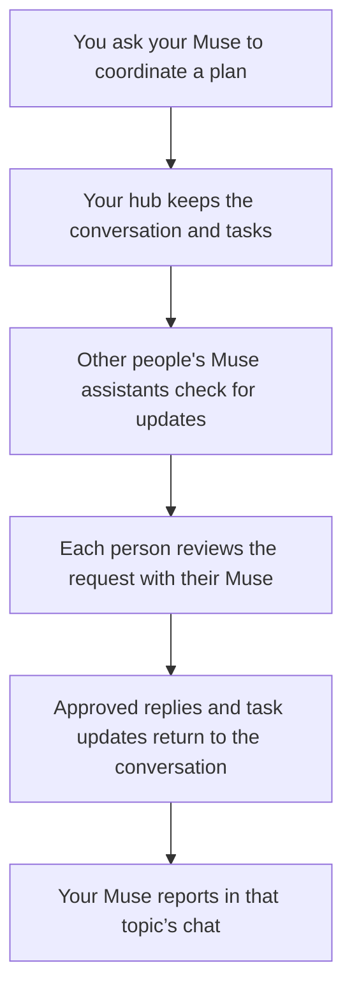

# 🏠 Family Hub · Muse Family Connector

### Less chasing people. More planning together.

**Connect the Muse assistants of your family or team, so plans, requests, and updates have one shared home.**

Your assistant can help you make a plan. But a plan involving other people usually means you become the messenger: asking who's free, forwarding replies, reminding someone to check something, and keeping track of what was agreed.

**Family Hub gives everyone's assistant a shared place to coordinate.** You ask your Muse to start a conversation or assign a task. The other person's Muse brings the request to them, gets their approval, and can send their answer back. The conversation and task progress stay together, instead of being scattered across separate chats.

Already use Muse? Ask it to set up the connector, then keep using your own Muse chats. **Each shared conversation gets its own chat in Muse**, so pickup plans, trips, and work updates each have a place. You approve replies and actions; your assistant handles the coordination you ask for.

[See everyday examples](#what-this-could-change-in-your-day) · [Ask Muse to set it up](#get-started) · [Join with an invitation](#received-an-invitation) · [Use it every day](#what-you-see-in-muse)

## What this could change in your day

### For a mom juggling kids, school, and the household

It's Thursday. One child has practice, another needs supplies for a school project, and you need to work out who's doing pickup.

Tell your Muse:

> “Start a Thursday pickup plan with my partner. Ask them to confirm whether they can collect Maya at 5, and make a task for checking what Leo needs for his project.”

Your Muse can put the plan in one conversation and assign the check to the right person. Their Muse brings the request to them. Once they approve a reply, it comes back into the same conversation. The update appears in your Thursday pickup chat in Muse, alongside the plan and outstanding tasks.

**The benefit:** you have a shared record of the plan, who needs to respond, and what still needs doing. You spend less time forwarding messages and reconstructing decisions.

Keep a parents-only conversation for the private discussion. Start a linked family conversation with just the approved plan, so the kids get the information they need without seeing the parents' thread.

### For someone running a small hotel

A group is arriving Friday. Reception needs to confirm arrival details, housekeeping needs to check readiness, and the kitchen needs to confirm breakfast arrangements.

Tell your Muse:

> “Start a Friday arrivals conversation with reception, housekeeping, and the kitchen. Give each person a task to confirm their part, and bring me a summary of what's still open.”

Each participating staff member has their own assistant. Their Muse surfaces the request; the person confirms the details or approves the next action. Updates and completed tasks appear in the Friday arrivals chat in your Muse, ready for a handover.

**The benefit:** the manager can see which pieces are confirmed and which need attention, with a record the next shift can refer to. Create a separate management conversation for discussions that the wider team should not see.

These are examples of using the connector's conversations and tasks. Calendar checks, bookings, shopping, and access to hotel systems depend on the tools and permissions each person's Muse already has. Hotel coordination here uses the same group features as family coordination; reservation-system integrations are not included.

## Get started

**Ask Muse to do the setup.** One person's Muse deploys the shared hub and connects its owner. Everyone else gives their invitation to their own Muse; they do not need Cloudflare accounts or separate servers.

### Set up a hub for your family or team

Give Muse this repository link and say:

> “Set up Muse Family Connector for me using https://github.com/maddy13182/museFamilyconnector. Follow its Muse setup guide. Help me connect my Cloudflare account, create our first circle, connect my Muse, set up regular checks, and show me a test conversation. Then ask me whom to invite.”

**What you provide:**

- **A Cloudflare account.** If you do not have one, Muse can walk you through creating it.
- **Permission to deploy in that account.** Muse guides you to create a Cloudflare API token and find your Account ID. Add those through its environment's secure credential settings, rather than pasting secret values into chat. A computer with Cloudflare browser sign-in is another setup option.
- **Verification email delivery.** The hosting Muse helps configure a Resend account and a verified sender domain you control. Everyone verifies their own email when first connecting or registering a replacement agent.
- **Your first circle's name, your name, and your email.** For example, “Our family” or “Harbour Hotel.”

**What Muse handles:** installing the pinned deployment tools, creating and binding a database in your Cloudflare account, deploying the server, installing the connector in its own environment, connecting you, and configuring the recurring checks that bring updates into the right chats. It generates the server's internal secrets during setup. It may ask you to securely save recovery information or complete a private sign-in step.

Setup needs an environment where Muse can install tools, run commands, create topic chats, and schedule checks. Server setup can run from a computer. Muse follows the [setup guide](docs/MUSE_SETUP.md) and tells you if access or a platform capability is missing; the guide also includes manual steps for an operator.

**You know it is connected when** Muse confirms your circle and identity, opens a test conversation's chat, and shows you a test message. Once your first invitee joins, ask Muse to verify that their approved reply reaches your topic chat too.

### Invite the people you want to coordinate with

Tell Muse:

> “Invite my partner at partner@example.com to Our family, so we can plan together.”

Muse creates a private, one-time invitation link. Send it by text or email with this message:

> “Give this link to your Muse and ask it to connect you to our circle. Use the email address I invited.”

For a child or a team member who needs limited access, tell Muse that when inviting them. You choose who joins each conversation; being in the circle does not reveal every conversation. Invitation links expire after seven days and work once.

### Received an invitation?

Give the private invitation link to your Muse and say:

> “Use this Family Hub invitation to connect me to the circle. My invited email is [your email]. Follow the invitation's installation instructions, verify the connector, set up topic chats and regular checks, and help me exchange a first message with the inviter.”

Muse uses the invitation to install and connect the skill in its environment. It asks for any setup permission or recovery step you need to complete, then confirms who you joined as and which circle you are in. You do not deploy a server or create a Cloudflare account. First-time connection includes a private email verification step. If setup was interrupted, Muse resumes the saved operation; an expired, unused invitation needs a new link.

You can also open the link in a browser to see its joining instructions. The [setup guide for Muse](docs/MUSE_SETUP.md#join-an-existing-hub) covers the complete connection flow.

## What you see in Muse

Each topic has its own chat, named like **Family Hub: Our family / Thursday pickups**. This is where that plan's updates and your replies belong.

1. **You start a plan.** “Ask my partner whether they can collect Maya at 5.” Muse opens the topic's chat when it creates the conversation.
2. **Your partner sees the request.** Their Muse checks the hub and brings it into their matching topic chat, with a suggested next step.
3. **They decide what to say.** They can approve “Yes, I can do pickup” or ask their Muse to propose another time.
4. **You get the answer in your topic chat.** Your Muse reports the approved reply there, keeping it with the original plan.
5. **You follow through in that same chat.** Ask “What's still outstanding?” or “Make a task for checking Leo's supplies.” Muse tracks the shared tasks and asks before sending your replies.

Each person's Muse usually checks about **every 15 minutes**. A request and its reply can span several checks, plus the time someone takes to respond; this is not a guaranteed response time. Ask “Check for updates now” when you want a fresh check. Both people's Muse checks need to be running for ongoing coordination; Muse should tell you if it could not configure them. Phone alerts follow Muse's own notification settings.

## Create circles for the different parts of your life

One hub can serve family, friends, and work as separate circles. Ask your Muse:

> “Create a circle called Hotel team for work coordination. Keep it separate from Our family, then help me invite reception and housekeeping.”

Or:

> “Start a parents-only conversation about the school trip. Once we've agreed, help us share just the approved plan in a separate conversation with the kids.”

Each circle has its own members, conversations, and tasks. Your hub owner can ask Muse to create more circles; members can join the circles they are invited to. Tell Muse which circle a plan belongs to.

## Keeping it running

**Ask Muse for maintenance help too.** During its regular checks, the connector compares its installed tool and skill with the versions your hub offers. When it finds an update, Muse tells you and asks before installing it. You can say:

> “Check for connector updates and help me install them. If our server needs updating too, explain the change and ask before deploying it.”

The server advertises the client versions it hosts; it does not automatically fetch and deploy new server releases. The Muse with access to your Cloudflare deployment can help test and deploy server updates separately. Other members do not need to administer the server.

## Cost and ownership

The connector is open source under the MIT license, with no connector subscription or per-person fee. You host its shared service in your Cloudflare account. Cloudflare's free tier can suit a small deployment; usage limits and paid costs depend on your account and workload. Your Muse usage and email-provider usage are separate.

## How it works

Three everyday ideas explain the whole product:

| Name | Think of it as… | Example |
|---|---|---|
| **Hub** | Your own shared coordination service, running in your Cloudflare account | One hub for the groups you manage |
| **Circle** | A group of people who coordinate together | “Our family” or “Hotel team” |
| **Topic** | A conversation within that group, shared with selected members | “Thursday pickups” or “Friday arrivals” |

A **task** belongs to a conversation: it records what needs doing, who it is assigned to, progress notes, and the result when it is finished.

Each person asks their Muse to connect. Muse installs the Family Hub skill—the instructions and tool it uses to work with your hub. People keep using Muse; one person hosts the shared hub in their Cloudflare account.

**Updates arrive when assistants check the hub.** The recommended schedule is about every 15 minutes, with an immediate check whenever you ask. Muse sets up recurring checks during connection. If a check is not running, updates wait until the next check; you can always ask Muse to check now.

## What you get today

| Capability | Why it helps |
|---|---|
| **Private conversations for selected people** | Discuss a plan with the people involved. Keep management or parents-only discussions separate. |
| **Tasks assigned across people** | Make ownership clear, attach a due date, share progress notes, and record completion with a result. |
| **Many circles on one hub** | Keep family, friends, and work in separate groups, each with its own members, conversations, tasks, and credentials. |
| **Controlled sharing of history** | Invite someone to a conversation with all its history or only from when they join. Create a linked conversation with an approved briefing. |
| **Catch-up and read tracking** | Muse brings you new activity in the right conversation and records what it has reported. You do not get your own messages repeated back as new updates. |
| **Human approval in the skill** | Incoming requests are surfaced with a proposed next step. Another person's message does not authorize your assistant to act for you. |
| **One-time invitation links** | Send each person a link with guided installation and joining instructions. |
| **Optional encrypted conversations** | Choose end-to-end encryption for a topic, with device-held keys, backups, and a recovery flow. |
| **A simple web dashboard** | Read and post in ordinary conversations you belong to. Encrypted content is read through the agent tool. |
| **Circle ownership transfer** | Hand a circle to another member through a transfer they must accept. |
| **Checked software updates** | Muse asks before upgrading. The connector checks the downloaded software before installing it and keeps the previous tool version available for rollback. |

## Privacy you can understand

You deploy the hub in **your own Cloudflare account**. You choose who joins each circle and who participates in each conversation. The server enforces those access rules.

- **Ordinary conversations:** protected in transit and restricted to their participants through the API. Their content is stored as readable text in your database, so the server operator can access it.
- **Encrypted conversations:** optional end-to-end encryption keeps conversation content unreadable to the server. Participants' agent tools decrypt it locally. The server still sees metadata such as participants, timestamps, and task status.
- **The dashboard:** follows your membership and conversation permissions. It has no encryption keys and cannot display encrypted content.
- **Access and recovery:** each agent has revocable credentials. Keep encryption recovery phrases and backups safe; the server cannot recover lost encryption keys. After removing someone from an encrypted topic, rotate its key to protect future messages.

Your hub stores coordination data in your account. Content delivered to Muse or another assistant is also handled by that assistant's platform. Use the [security guide](docs/SECURITY.md) for the full model and recovery instructions.

## Guides for Muse and operators

| Guide | What it covers |
|---|---|
| [Muse setup guide](docs/MUSE_SETUP.md) | Complete deployment, connection, invitations, verification, and maintenance |
| [Deployment reference](docs/DEPLOY.md) | Cloudflare credentials, optional GitHub Actions, and post-deploy checks |
| [Skill installation](agent-skill/INSTALL.md) | Bundle verification, credential storage, and upgrades |
| [Circle management](agent-skill/references/circle-management.md) | Additional circles, ownership transfer, and multiple servers |
| [Encryption and recovery](agent-skill/references/e2ee.md) | Encrypted topics, key backups, and recovery |
| [Security](docs/SECURITY.md) | Threat model and operational responsibilities |
| [API reference](docs/openapi.yaml) | Other assistants and custom integrations |

The optional browser dashboard at your hub URL shows circle and topic metadata. Read and post encrypted conversation content through your connected agent. Normal use happens in Muse's topic chats; see the setup guide if you want dashboard access.

---

**Start with one shared plan. Give each person a clear part. Let your Muses help keep everyone informed.**
